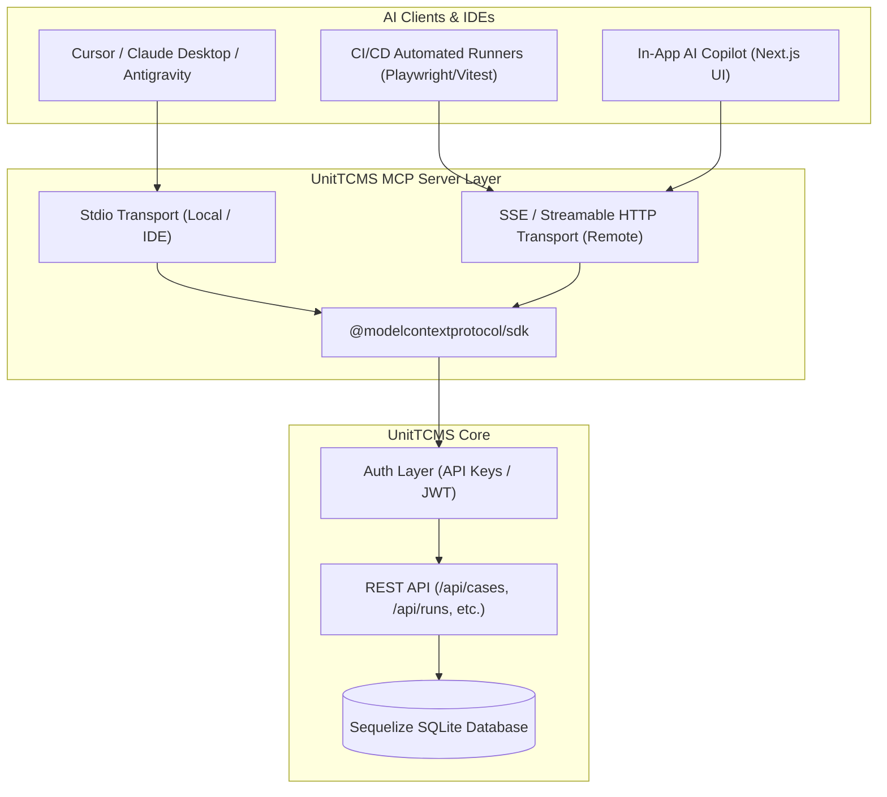

# Rencana Implementasi MCP (Model Context Protocol) Tools pada UnitTCMS

Dokumen ini merangkum analisis arsitektur dan rencana aksi penerapan Model Context Protocol (MCP) untuk platform **UnitTCMS**.

---

## 1. Ringkasan Eksekutif & Latar Belakang

**UnitTCMS** adalah sistem manajemen uji coba (Test Case Management System) mandiri (self-hosted) berbasis web. 
- **Frontend**: Next.js 14 (App Router `[locale]`), React 18, Tailwind CSS, HeroUI.
- **Backend**: Express 5, TypeScript (ESM), Sequelize ORM (SQLite3), TSOA Swagger OpenAPI.
- **Entitas Utama**: Projects, Folders, Test Cases (Steps, Preconditions, Expected Results), Runs, RunCases (Status, Comments, Attachments), Users & Members.

Dengan mengadopsi **MCP (Model Context Protocol)**, UnitTCMS dapat dihubungkan langsung ke berbagai AI Clients (Cursor, Claude Desktop, Antigravity, VS Code Copilot, agen otomatis CI/CD) maupun menyediakan asisten cerdas (AI Copilot) di dalam antarmuka webnya.

---

## 2. Arsitektur Penerapan

Penerapan dirancang menggunakan pendekatan modular yang fleksibel:



---

## 3. Katalog MCP Tools yang Direncanakan

### A. Manajemen Proyek & Modul (Hierarchy)
1. `unittcms_list_projects`: Mengambil daftar proyek aktif beserta ID dan deskripsinya.
2. `unittcms_get_project`: Mengambil detail proyek tertentu termasuk statistik status test case.
3. `unittcms_list_folders`: Mengambil hierarki pohon modul/folder dalam proyek.
4. `unittcms_create_folder`: Membuat modul/folder baru untuk mengelompokkan test case.

### B. Manajemen Test Cases
5. `unittcms_list_cases`: Mengambil daftar test case dalam proyek atau folder tertentu dengan filter (priority, state, type).
6. `unittcms_get_case_detail`: Mengambil informasi mendalam dari suatu test case (langkah pengujian/steps, prasyarat/preconditions, hasil yang diharapkan/expected results, tag).
7. `unittcms_create_test_case`: Membuat test case baru secara terstruktur.
8. `unittcms_bulk_create_cases`: Menerima daftar test case yang digenerate oleh AI dan menyimpannya secara batch.
9. `unittcms_update_test_case`: Memperbarui skenario, langkah pengujian, atau status test case.

### C. Eksekusi Uji Coba & Pelaporan (Test Runs & Execution)
10. `unittcms_create_test_run`: Membuat sesi pengujian baru (Test Run) untuk target rilis atau fitur.
11. `unittcms_list_runs`: Melihat daftar test run aktif maupun historis.
12. `unittcms_update_run_case_result`: Mencatat hasil uji coba (*Passed*, *Failed*, *Blocked*, *Untested*) untuk test case tertentu dalam run, lengkap dengan catatan kegagalan (error log / failure summary).
13. `unittcms_get_run_summary`: Menghasilkan ringkasan metrik eksekusi (Pass rate, failure breakdown).

---

## 4. MCP Resources & Prompts

* **Resources**:
  * `unittcms://projects/{projectId}/overview`: Ringkasan status pengujian proyek.
  * `unittcms://runs/{runId}/report`: Laporan lengkap eksekusi test run.
* **Prompts**:
  * `generate_test_cases_from_user_story`: Prompt template terstandar untuk mengekstrak Acceptance Criteria menjadi sekumpulan Test Cases siap pakai.
  * `analyze_failed_test_run`: Prompt untuk menganalisis log kegagalan dan memberikan rekomendasi perbaikan bug.

---

## 5. Rencana Tahapan Eksekusi (Implementation Milestones)

| Milestone | Aktivitas Utama | Output |
|---|---|---|
| **M1: Auth & API Key** | Tambahkan dukungan Personal Access Token (PAT) / API Key di tabel `users` backend agar agent dapat beroperasi tanpa token sesi browser 24 jam. | API Key Auth Middleware |
| **M2: MCP Server Core** | Inisialisasi package `@modelcontextprotocol/sdk` (paket baru e.g., `packages/mcp-server` atau `backend/mcp`), setup Stdio dan HTTP/SSE transport. | MCP Server Skeleton |
| **M3: Implementasi Tools** | Hubungkan skema Zod MCP ke endpoint API backend untuk semua tools CRUD cases & runs. | 13+ MCP Tools Siap Pakai |
| **M4: Verifikasi & Konfigurasi IDE** | Uji coba integrasi dengan Cursor, Claude Desktop, dan Antigravity via file konfigurasi MCP (`mcp.json`). | Konfigurasi IDE teruji |
| **M5: In-App UI Copilot** *(Opsional)* | Menambahkan tombol "AI Test Generator" di UI Next.js untuk membuat test case otomatis dari deskripsi requirement. | Fitur AI di Web UI |

---

## 6. Contoh Konfigurasi MCP Client (`mcp.json` / Claude Config)

```json
{
  "mcpServers": {
    "unittcms": {
      "command": "node",
      "args": ["C:/Users/zoelt/my_project/unittcms/backend/mcp/dist/index.js"],
      "env": {
        "UNITTCMS_BASE_URL": "http://localhost:8000/api",
        "UNITTCMS_API_KEY": "your_api_key_here"
      }
    }
  }
}
```
